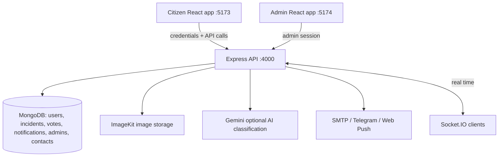

# CivicAlert architecture

## Main components

Citizen login uses Google Identity Services to obtain a Google-signed credential. Express validates that ID token against the configured Google client ID and creates a session in a secure HttpOnly cookie. A separate admin JWT/cookie represents an administrator account. All admin permissions are enforced on the Express API.

## Report creation path

1. Location gate asks for location permission; React receives browser Geolocation coordinates.
2. Registered user enters 15+ characters and uploads JPG/PNG/WebP (max 6 MB).
3. Express `multer` validates file MIME/size, then uploads bytes to ImageKit.
4. ImageKit returns URL + file ID. Only these are persisted in the MongoDB incident document.
5. Optional Gemini analysis suggests category, severity and caution; it never declares an incident authentic. If unavailable, use an explicit AI warning.
6. Express queries nearby reports in a 200 m / 6 hour window and adds duplicate **suggestions** on similar descriptions.
7. Incident is created publicly as `unverified`, independent of AI outcome.
8. Express finds signed-in users with a location fix updated within 2 minutes, within 1 km, and queues best-effort in-app/SMTP/Telegram/Push notifications.
9. A qualified citizen requests a fresh GPS fix to vote; backend checks the reporter is not the voter, recent server-recorded position, and distance.
10. A single vote per citizen/incident is inserted or updated (unique MongoDB index). Aggregate state is recomputed: `yes >= 5 && yes / (yes+no) >= 0.75`. Reversal to Unverified is supported.

**Caution:** Browser-provided geolocation can be manipulated. This MVP does not provide fraud-proof proof-of-presence. In addition, notifications rely on recent active-session locations, not background GPS after the browser closes.

## Database collections

- `users`: Google identity, preferences, optional last geolocation, push and Telegram links.
- `incidents`: description, photo URL/ID, GeoJSON point, AI advisory, severity, verification and aggregate votes.
- `votes`: user + incident unique key with Yes/No.
- `notifications`: recipient, incident reference, read status.
- `admins`: main and sub-admin accounts, Argon2 or bcrypt hashes (current code uses bcrypt), permissions.
- `authoritycontacts`: department, district/state, verified email flag.
- `authoritydispatches`: sent message, recipient contact, approving admin, timestamp.
- `audits`: minimal operational action trail.

## Deployment concepts (not deployed by this project)

- Serve citizen and admin through separate frontends, e.g. `app.example.com`, `admin.example.com`.
- Serve API under a common-site hostname, e.g. `api.example.com`; configure origin allowlist for exact frontends.
- Use HTTPS, compliant cookie settings, and a supervised database deployment.
- Keep ImageKit, Google, Gemini, SMTP, Telegram and VAPID private secrets only on the API server.
- Admin portal should have extra access controls and 2FA before being exposed publicly.
